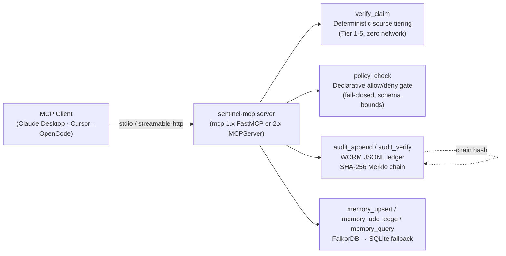

# sentinel-mcp

mcp-name: io.github.Sandeep-Hipparagi/sentinel-mcp

**Registry-ready MCP server for governed agents: deterministic claim verification, a fail-closed policy gate, a Merkle-chained WORM audit ledger, and graph memory that degrades gracefully — installable with one command.**

[](https://github.com/Sandeep-Hipparagi/sentinel-mcp/actions/workflows/ci.yml)
[](pyproject.toml)
[](https://modelcontextprotocol.io)
[](LICENSE)

## Architecture



## Measured conformance & throughput (this build)

| Check | Result |
| :--- | :--- |
| Conformance self-test | **12/12 PASS** (`sentinel-mcp conformance`) |
| `verify_claim` latency (n=1000) | **p50 0.013 ms · p95 0.014 ms · p99 0.018 ms** (budget: p95 < 5 ms) |
| `policy_check` latency (n=1000) | **p50 0.005 ms · p95 0.005 ms · p99 0.006 ms** |
| Tamper detection (single + multi-block, deletion, append-after-tamper) | **100% caught, first bad sequence pin-pointed** |
| Tests | **76/76** pytest · mypy `--strict` · ruff clean |

Reproduce: `pip install -e ".[dev]" && pytest && sentinel-mcp conformance`.

## Quickstart (3 commands)

```bash
pip install -e ".[dev]"          # or: pip install sentinel-mcp-guard
sentinel-mcp conformance          # self-test: 12 checks incl. tamper + latency
sentinel-mcp serve                # stdio MCP server
```

## Client setup

**Claude Desktop** (`claude_desktop_config.json`):
```json
{"mcpServers": {"sentinel-mcp": {"command": "sentinel-mcp", "args": ["serve", "--transport", "stdio"]}}}
```

**Cursor / OpenCode / any streamable-HTTP client:**
```bash
sentinel-mcp serve --transport http --port 8000
```

Full example configs: [`examples/claude_desktop.json`](examples/claude_desktop.json). Registry manifest: [`server.json`](server.json).

## Tool reference

| Tool | Input | Output | Guarantees |
| :--- | :--- | :--- | :--- |
| `verify_claim` | `claim_text`, `url?` | `citable`, `source_tier` (1–5), `tier_name`, `risk_flags`, `rationale` | Deterministic rules; zero network, zero API keys; typosquat lookalikes forced to Tier 5 |
| `policy_check` | `tool_name`, `args` | `allowed`, `reason_code` | Declarative allowlist + argument bounds; prototype-pollution keys denied; payload-size cap; **fail-closed** |
| `audit_append` | `event` | `sequence`, `entry_hash`, `merkle_root` | Append-only JSONL; `SHA-256(prev_hash ‖ canonical(entry))` |
| `audit_verify` | — | `valid`, `length`, `merkle_root`, `first_bad_sequence?` | Full chain replay; pin-points the first mutated block |
| `memory_upsert` | `node_id`, `labels?`, `properties?` | `backend`, `node_id` | Idempotent; backend observable |
| `memory_add_edge` | `src`, `relation`, `dst` | `backend`, `edge` | Relation names validated (`^[A-Za-z][A-Za-z0-9_]*$`) |
| `memory_query` | `node_id`, `max_depth?` (1–6) | `backend`, `nodes`, `edges` | FalkorDB when reachable, embedded SQLite otherwise |

## Dual-generation MCP SDK support

`sentinel-mcp` detects the installed `mcp` SDK and serves through the matching
API: **2.x `MCPServer`** (`add_tool` + `run_stdio_async`/`run_streamable_http_async`)
or **1.x `FastMCP`** (`add_tool` + `run(transport=...)`). Tool logic is pure
Python and identical across generations; conformance verifies the wiring.

## Security posture

- **Fail-closed everywhere**: unknown tools, out-of-bounds arguments, and
  infrastructure errors are denied (`POL_*` / `NATIVE_DRIVER_ERROR`-style reason codes).
- **Tamper-evident audit**: 100% of single-block mutations, multi-block
  mutations, deletions, and append-after-tamper scenarios are detected in tests.
- **No secrets**: no API keys, no network calls in tool logic; the SQLite
  fallback means the server always boots.
- **Supply chain**: two runtime dependencies (`mcp`, `pydantic`) plus CLI
  conveniences; OIDC-only PyPI publishing.

## Development

```bash
ruff check . && ruff format --check .   # lint + format
mypy --strict src tests                 # full strict typing
pytest                                  # 76 tests
sentinel-mcp conformance                # 12-check self-test
```

See [CONTRIBUTING.md](.github/CONTRIBUTING.md) and [SECURITY.md](.github/SECURITY.md).

## Ecosystem

Part of the governed-agent stack measured by
[`agent-benchmark-suite`](https://github.com/Sandeep-Hipparagi/agent-benchmark-suite).

## License

MIT — see [LICENSE](LICENSE).
